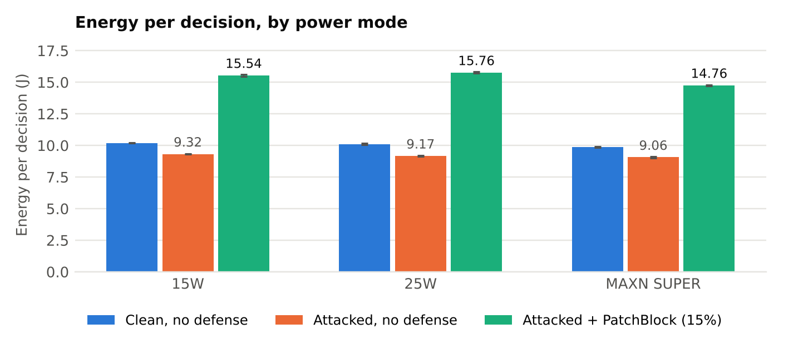
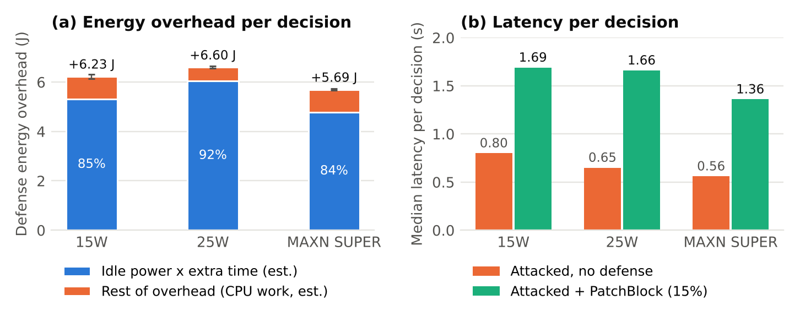
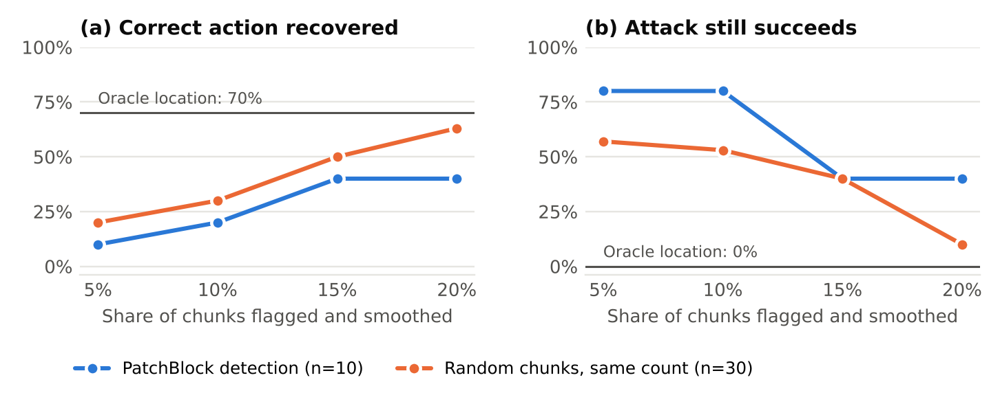

# PatchBlock in Front of a Vision-Language Agent on Jetson Orin Nano

An extension of **PatchBlock** ([Chattopadhyay et al., DATE 2026, arXiv:2601.00367](https://arxiv.org/abs/2601.00367)), a lightweight CPU-side defense against adversarial patches, into two settings its published evaluation does not cover:

1. **A vision-language model driving an agent.** PatchBlock was evaluated on ResNet, VGG, ViT and YOLOv4. Here it runs in front of SmolVLM-500M, which looks at an image and picks one action: MOVE, STOP, FLAG or REPORT.
2. **Energy on the target hardware, across power modes.** The paper reports joules for a laptop and only runtime for Jetson devices. Here energy per decision is measured on a Jetson Orin Nano in its 15W, 25W and MAXN SUPER modes, using the board's onboard power monitor.

This is a reimplementation and an extension of published work, not a new defense. Full write-up: [`report/patchblock_vlm_technical_report.pdf`](report/patchblock_vlm_technical_report.pdf).

**Author:** Fanuel Petros

## Results at a glance

| Question | Result |
|---|---|
| Does a per-image patch change the agent's action? | Yes, on **10 of 10** scenes (targeted) |
| Does PatchBlock's mitigation stage work? | Yes, when aimed at the patch: the attack held on **0 of 10** scenes |
| Does PatchBlock's detection stage find the patch? | **No better than chance** in this reimplementation (precision 0.03 to 0.07, chance 0.066) |
| Best recovery of the correct action | **4 of 10** (15% of chunks flagged); smoothing random chunks did as well or better |
| Energy cost of the defense | **+5.69 to +6.60 J per decision (+63% to +72%)**, spread across 3 runs at most 0.1 J |
| Latency cost | **+0.80 to +1.01 s** per decision (roughly double) |
| Most energy-efficient power mode | **MAXN SUPER**, but it hit the stock supply's over-current limit 4 times |







### Energy per decision (attacked inputs, mean ± SD over 3 runs)

| Mode | Undefended | Defended (PatchBlock, 15%) | Overhead | Latency |
|---|---|---|---|---|
| 15W | 9.32 ± 0.01 J | 15.55 ± 0.09 J | +6.23 J (+66.8%) | 0.80 → 1.69 s |
| 25W | 9.17 ± 0.04 J | 15.76 ± 0.06 J | +6.60 J (+72.0%) | 0.65 → 1.66 s |
| MAXN SUPER | 9.06 ± 0.05 J | 14.76 ± 0.05 J | +5.69 J (+62.8%) | 0.56 → 1.36 s |

An estimated 84% to 92% of the defense's energy is the board's ~6 W baseline power during the extra time, not the CPU work itself. A faster or pipelined detection stage would remove most of the cost.

## What these results do and do not show

- The patches are **per-image, digital and white-box**: each one is fitted to a single image. They are not universal, not printed, not seen through a camera, and not optimized against the defense.
- Per-image patches are fragile, so smoothing almost any part of them breaks the attack. That is why random chunks recover as many scenes as PatchBlock. The detection stage needs a robust patch to be tested fairly.
- The defense results describe **this reimplementation** (deviations below), not the published PatchBlock.
- The energy results are independent of how well the defense works and are the main contribution.

## Hardware and software

- NVIDIA Jetson Orin Nano (Seeed carrier), JetPack 6.2 (L4T R36.4.3), CUDA 12.6, Python 3.10
- PyTorch 2.8.0 and torchvision 0.23.0 from the jetson-ai-lab index, transformers 4.49.0, scikit-learn, NumPy 1.26.4
- Model: `HuggingFaceTB/SmolVLM-500M-Instruct`, float32, greedy decoding, one 512 x 512 image tile
- Scenes: 10 COCO val2017 images (IDs 139, 285, 632, 724, 776, 785, 802, 872, 885, 1000)

## Repository layout

| File | Phase | Purpose |
|---|---|---|
| `setup.sh` | 1 | Create the venv and install the pinned stack |
| `check_env.py` | 1 | Check that the GPU is visible and the camera works |
| `smolvlm_baseline.py` | 1 | First latency baseline (float16, default preprocessing) |
| `power_logger.py` | 1 | Energy-measurement self-test via tegrastats |
| `fetch_scenes.py` | 2 | Download the 10 COCO scenes |
| `attack_eval.py` | 2 | Craft per-image targeted patches, measure attack success |
| `patchblock.py` | 3 | PatchBlock reimplementation: chunking, Isolation Forest on MI features, SVD |
| `defense_eval.py` | 3 | Apply PatchBlock and controls (oracle location, full-image SVD) |
| `random_control.py` | 3 | Random-chunk control at the same flag fractions |
| `energy_sweep.py`, `run_sweep.sh` | 4 | Energy and latency per decision across power modes, repeated runs |
| `report/` | 5 | Technical report PDF, figures, and the scripts that build them |
| `logs/` | 3, 4 | Console output of the Phase 3 and Phase 4 runs |

## Reproduce

Run everything on the Jetson, from the repository folder.

```bash
bash setup.sh
source ~/patchblock-venv/bin/activate
sudo nvpmodel -m 1                                     # 25W, used for Phases 2 and 3

# Phase 2: attack (about 35 min for 10 scenes)
python fetch_scenes.py
python -u attack_eval.py --scenes scenes_coco 2>&1 | tee eval_log.txt

# Phase 3: defense and controls (about 5 + 8 min)
python -u defense_eval.py 2>&1 | tee defense_log.txt
python -u random_control.py 2>&1 | tee random_log.txt

# Phase 4: energy, 3 runs with different mode orders (about 50 min)
bash run_sweep.sh 1 "0 1 2" 2 "2 1 0" 3 "1 2 0" 2>&1 | tee sweep_log.txt

# Phase 5: figures and report
python report/charts.py && python report/build_tech_report.py
```

All evaluation scripts write a CSV after every scene or condition and accept `--resume`. Close other applications before the energy sweep; they add power draw.

## Deviations from the PatchBlock paper

- Standard Isolation Forest (scikit-learn), not the paper's Fast Isolation Forest with gradient-based cuts. CPU times are therefore not comparable to the paper's.
- The paper describes mutual information both across colour channels and between neighbouring chunks; both are used as features.
- Stride and outlier threshold are not given unambiguously: chunks are non-overlapping 50 px, and the flagged fraction is swept over 5% to 20%.
- PatchBlock runs on the CPU before GPU inference, not in parallel with it.

## Limitations

- 10 scenes, one board, float32 inference.
- Clean and attacked energy differ partly because the answers differ in length ("REPORT." versus "STOP."), not only because of the attack.
- The cause of the slower PatchBlock CPU step at 25W than at 15W was not identified; CPU clocks were not logged.
- Remote-desktop software ran in the background (no viewer connected) during the energy runs. The first energy run has no GPU clock data.

## References

1. N. Chattopadhyay, A. Basit, A. Guesmi, M. A. Hanif, B. Ouni, M. Shafique, "PatchBlock: A Lightweight Defense Against Adversarial Patches for Embedded EdgeAI Devices," DATE 2026, [arXiv:2601.00367](https://arxiv.org/abs/2601.00367).
2. N. Chattopadhyay et al., "ODDR: Outlier Detection & Dimension Reduction Based Defense Against Adversarial Patches," ICCV 2025.
3. N. Chattopadhyay, A. Guesmi, M. Shafique, "Anomaly Unveiled: Securing Image Classification against Adversarial Patch Attacks," [arXiv:2402.06249](https://arxiv.org/abs/2402.06249).
4. N. Chattopadhyay et al., "Defending against Adversarial Patches using Dimensionality Reduction," DAC 2024, [arXiv:2311.12211](https://arxiv.org/abs/2311.12211).
5. M. Shafique et al., "Adversarial and Backdoor Threats in Autonomous-Vehicle and Embodied-AI Systems," SOCC 2025.

The full reference list is in the report.
